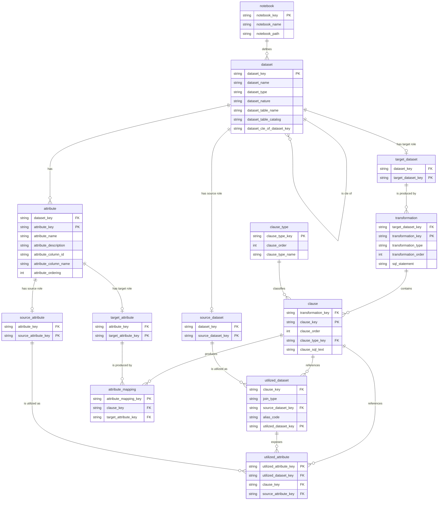

# Datamodel : Technical Data Lineage

## Unity Catalog Dedicated Tables

To be able determine the technical data lineage, it is essential to have a clear understanding of the relationships between the source datasets, the transformations applied, and the resulting target datasets. The data model of Unity Catalog dedicated tables provides the necessary structure to capture and represent these relationships effectively.

| Table Name | Description |
|------------|-------------|
| `transformation` | A single data transformation (insert, update, delete, merge, or CTE) that populates a target dataset. A dataset can have multiple transformations (e.g. unions, CTEs, separate insert/update statements). |
| `clause_type` | Lookup table of SQL clause types (e.g. `select`, `from`, `where`, `group by`, `having`) that can be assigned to a `clause`. |
| `clause` | An individual SQL clause (select/from/where/group by/having) belonging to a `transformation`. |
| `target_dataset` | Role entity that marks a `dataset` as the target (output) of one or more transformations. |
| `utilized_dataset` | A dataset used as input (from/join) within a `clause`, including the join type and alias used. |
| `source_dataset` | Role entity that marks a `dataset` as a source (input) used by one or more transformations. |
| `dataset` | Generic registry of every dataset (table/view) known to the lineage model, holding its catalog, schema/table name, type, and nature. |
| `utilized_attribute` | An attribute (column) used within a `clause`, linked to the `utilized_dataset` that supplies it. |
| `source_attribute` | Role entity that marks an `attribute` as a source (input) column used in transformations. |
| `attribute` | Generic registry of every attribute (column) belonging to a `dataset`. |
| `attribute_mapping` | The mapping between a `clause` (e.g. a select item) and the `target_attribute` it populates. |
| `target_attribute` | Role entity that marks an `attribute` as a target (output) column produced by transformations. |

***Entity Relationship Diagram***

### `transformation`

Represents a single data transformation statement (insert, update, delete, merge, or a CTE) that (de-)populates a target dataset. A target dataset can be populated by multiple transformations (e.g. unions or separate CTEs), the transformations can be related to each other through `transformation_parent_key`, forming a hierarchical structure, allowing for the representation of complex SQL logic such as nested CTEs. Every transformation is uniquely related to a target dataset and can have one and only one dataset as its target. However a target dataset can have one or more transformations populating if unions, merges, updates or deletes are involved.

| Column | Description | Key | References |
|--------|-------------|-----|------------|
| `target_dataset_key` | Identifies the `target_dataset` that this transformation populates. | FK | `target_dataset.target_dataset_key` |
| `transformation_key` | Unique identifier of the transformation. | PK | - |
| `transformation_type` | The type of transformation, e.g. `insert`, `update`, `delete`, `merge`. | - | - |
| `transformation_order` | The execution/processing order of the transformation relative to others on the same target dataset. | - | - |
| `sql_statement` | The actual SQL statement of the transformation. | - | - |

### `clause_type`

Lookup table that classifies the kind of SQL clause represented by a `clause` row.

| Column | Description | Key | References |
|--------|-------------|-----|------------|
| `clause_type_key` | Unique identifier of the clause type. | PK | - |
| `clause_order` | The default/expected ordering of this clause type within a transformation (e.g. from before where before group by). | - | - |
| `clause_type_name` | The name of the clause type, e.g. `select`, `from`, `where`, `group by`, `having`, howerver other clause like `delete`, `update`, `merge` can also exist. | - | - |

### `clause`

Represents an individual SQL clause (select/from/where/group by/having) belonging to a `transformation`. Other clause types like `delete`, `update`, and `merge` are also represented here. But also the FROM clause is treated specially as it can reference multiple source datasets. SELECT clauses are split into individual columns for more granular lineage tracking. `WHERE`, `GROUP BY` and `HAVING` clauses are separated in individuals records.

| Column | Description | Key | References |
|--------|-------------|-----|------------|
| `transformation_key` | Identifies the transformation this clause belongs to. | FK | `transformation.transformation_key` |
| `clause_key` | Unique identifier of the clause. | PK | - |
| `clause_order` | The ordering of this clause within its transformation, this is based on their appreance in the SQL statement, i.e., the sequence in which the clauses appear in the SQL query. This helps in reconstructing the logical flow of the SQL statement. | - | - |
| `clause_type_key` | Identifies the type of this clause. | FK | `clause_type.clause_type_key` |
| `clause_sql_text` | The raw SQL text of the clause. | - | - |

### `target_dataset`

Role entity that marks a `dataset` as the target (output) of one or more transformations. A dataset used as a target can later also be used as a source in subsequent transformations (represented separately via `source_dataset`).

| Column | Description | Key | References |
|--------|-------------|-----|------------|
| `dataset_key` | Identifies the underlying generic dataset. | FK | `dataset.dataset_key` |
| `target_dataset_key` | Unique identifier of this target-dataset role record. | PK | - |

### `utilized_dataset`

Represents a dataset used as input (via `from`/join) within a `clause`, including the join type and alias used in the transformation.

| Column | Description | Key | References |
|--------|-------------|-----|------------|
| `clause_key` | Identifies the clause (typically a `from` clause) in which this dataset is utilized. | FK | `clause.clause_key` |
| `join_type` | The type of join used for this dataset, e.g. `from`, `inner`, `left`, `right`, `full`, `cross`. | - | - |
| `source_dataset_key` | Identifies the source-dataset role record being utilized. | FK | `source_dataset.source_dataset_key` |
| `alias_code` | The alias used for this dataset in the transformation. | - | - |
| `utilized_dataset_key` | Unique identifier of this utilized-dataset record. | PK | - |

### `source_dataset`

Role entity that marks a `dataset` as a source (input) used by one or more transformations.

| Column | Description | Key | References |
|--------|-------------|-----|------------|
| `dataset_key` | Identifies the underlying generic dataset. | FK | `dataset.dataset_key` |
| `source_dataset_key` | Unique identifier of this source-dataset role record. | PK | - |

### `dataset`

Generic registry of every dataset (table/view) known to the lineage model, regardless of whether it is used as a source, a target, or both. A dataset is not just only the physical table or view, but also a logical entity that can participate in multiple transformations, think of the temporal views, derived tables that are temporary created in a notebook and later dropped, yet still maintaining their transformation. Transformation/Queries themselves may have complext logic that is defined in CTEs (Common Table Expressions) or sub-queries in the FROM/JOIN clauses. Basically everthing that starts with `SELECT` is considered a dataset in the lineage model. This approach ensures that all intermediate and derived datasets are tracked, providing a complete picture of the data flow and dependencies within the system. This comprehensive tracking allows for better impact analysis, debugging, and optimization of data pipelines, as well as ensuring compliance with data governance policies. It also facilitates the identification of redundant or obsolete datasets, enabling more efficient resource management and data lifecycle governance. In essence, the `dataset` entity serves as the cornerstone of the technical data lineage model, capturing both the physical and logical aspects of data assets across the entire data ecosystem. By maintaining this level of granularity, organizations can achieve a high degree of transparency and control over their data assets, ultimately leading to more reliable and trustworthy data-driven decision-making.

| Column | Description | Key | References |
|--------|-------------|-----|------------|
| `dataset_key` | Unique identifier of the dataset. | PK | - |
| `dataset_table_id` | The Table ID used to uniquely identify the underlying Unity Catalog table/view. | - | - |
| `dataset_name` | The descriptive name of the dataset. | - | - |
| `dataset_type` | The type of dataset, e.g. `table` or `view`. | - | - |
| `dataset_nature` | The nature of the dataset, e.g. whether it is a base, staging, or gold dataset. | - | - |
| `dataset_table_name` | The physical catalog table/view name. | - | - |
| `dataset_table_catalog` | The Unity Catalog catalog name of the dataset. | - | - |
| `dataset_cte_of_dataset_key` | Identifies the dataset that this dataset is a CTE of. | FK | `dataset.dataset_key` |

### `utilized_attribute`

Represents an attribute (column) used within a `clause` (e.g. a join condition), linked to the `utilized_dataset` that supplies it.

| Column | Description | Key | References |
|--------|-------------|-----|------------|
| `utilized_attribute_key` | Unique identifier of this utilized-attribute record. | PK | - |
| `utilized_dataset_key` | Identifies the utilized dataset that supplies this attribute. | FK | `utilized_dataset.utilized_dataset_key` |
| `clause_key` | Identifies the clause in which this attribute is used. | FK | `clause.clause_key` |
| `source_attribute_key` | Identifies the source-attribute role record being utilized. | FK | `source_attribute.source_attribute_key` |

### `source_attribute`

Role entity that marks an `attribute` as a source (input) column used in transformations.

| Column | Description | Key | References |
|--------|-------------|-----|------------|
| `attribute_key` | Identifies the underlying generic attribute. | FK | `attribute.attribute_key` |
| `source_attribute_key` | Unique identifier of this source-attribute role record. | PK | - |

### `attribute`

Generic registry of every attribute (column) belonging to a `dataset`, regardless of whether it is used as a source, a target, or both.

| Column | Description | Key | References |
|--------|-------------|-----|------------|
| `dataset_key` | Identifies the dataset this attribute belongs to. | FK | `dataset.dataset_key` |
| `attribute_key` | Unique identifier of the attribute. | PK | - |
| `attribute_name` | The descriptive name of the attribute. | - | - |
| `attribute_description` | A description of the attribute. | - | - |
| `attribute_column_id` | The ordinal/technical ID of the column in the underlying table/view. | - | - |
| `attribute_column_name` | The physical column name. | - | - |
| `attribute_ordering` | The ordering position of the attribute/column within its dataset. | - | - |

### `attribute_mapping`

Represents the mapping between a `clause` (e.g. a select item) and the `target_attribute` it populates.

| Column | Description | Key | References |
|--------|-------------|-----|------------|
| `attribute_mapping_key` | Unique identifier of this attribute-mapping record. | PK | - |
| `clause_key` | Identifies the clause (typically a `select` clause) that defines this mapping. | FK | `clause.clause_key` |
| `target_attribute_key` | Identifies the target-attribute role record being populated. | FK | `target_attribute.target_attribute_key` |

### `target_attribute`

Role entity that marks an `attribute` as a target (output) column produced by transformations.

| Column | Description | Key | References |
|--------|-------------|-----|------------|
| `attribute_key` | Identifies the underlying generic attribute. | FK | `attribute.attribute_key` |
| `target_attribute_key` | Unique identifier of this target-attribute role record. | PK | - |

### `notebook`

Registry of notebooks where datasets, clauses, and transformations are defined.

| Column | Description | Key | References |
|--------|-------------|-----|------------|
| `notebook_id` | Unique identifier of the notebook. | PK | - |
| `notebook_path` | The path of the notebook. | - | - |
| `notebook_name` | The name of the notebook (without the file extension). | - | - |
| `notebook_extention` | The file extension of the notebook (e.g., `.sql`, `.py`). | - | - |
| `created_date` | The date when the notebook was created. | - | - |
| `last_modified_date` | The date when the notebook was last modified. | - | - |
| `language` | list of the programming language used in the notebook. | - | - |

## Implementation of Unity Catalog Tables in Databricks

### `information_schema_extented`-schema

The `information_schema_extented`-schema in Unity Catalog contains tables that store metadata about datasets, clauses, attributes, and their relationships. Below are the implementations of these tables in Databricks.

### historical-information

Historical lineage tables are stored in the `information_schema_extented`-schema and are identified by the `_his` postfix on the base table name, for example `dataset_his` and `transformation_his`. These tables store historical changes and versions of datasets, clauses, and attributes. This allows tracking the evolution of the technical data lineage over time. For this purpose the `meta`-columns `meta_valid_from`, `meta_valid_to`, and `meta_is_actual` are used to indicate the validity period and the current status of each record.

The historical table set follows the current-state model one to one: `notebook_his`, `dataset_his`, `source_dataset_his`, `target_dataset_his`, `attribute_his`, `source_attribute_his`, `target_attribute_his`, `clause_type_his`, `transformation_his`, `clause_his`, `utilized_dataset_his`, `utilized_attribute_his`, and `attribute_mapping_his`.

### Updating the technical-data-lineage information

Updating the technical-data-lineage information involves ensuring that the `current`-state of the data is accurately reflected in the historical `_his` tables in the `information_schema_extented`-schema. This involces the following steps:

1. Trancate the `current`-state tables to remove outdated information.
2. Populate the `current`-state tables with the latest data from the notebooks and transformations.
3. Validate the updated `current`-state to ensure consistency and accuracy.
4. Merge the validated `current`-state back into the historical `_his` tables in the `information_schema_extented`-schema.

