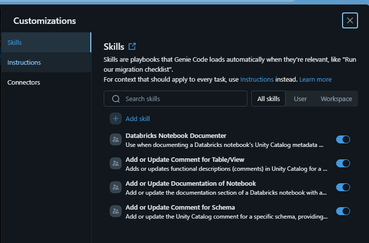
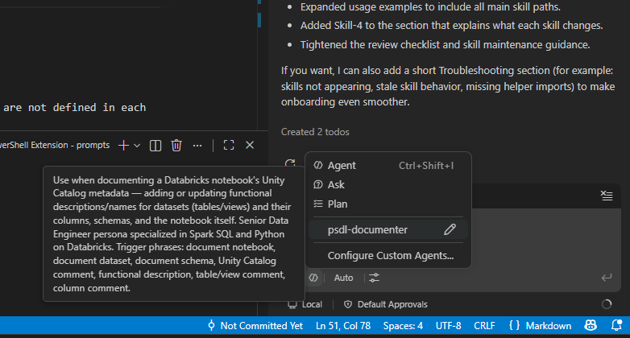

# Genie Code Documentation Skills

This repository contains Genie Code skills for documenting Databricks notebooks and Unity Catalog metadata: table or view comments, column comments, schema comments, notebook documentation, and volume comments.

## What is a skill?

A skill is a folder that contains a SKILL.md file. That file starts with YAML frontmatter, usually with at least name and description, followed by Markdown instructions.

Genie Code uses each skill description to decide when to auto-load a skill based on your prompt. You can also force a specific skill by mentioning it with @ in chat.

Reference: [Extend Genie Code with agent skills](https://learn.microsoft.com/en-us/azure/databricks/genie-code/skills/)

## Repository layout

```text
wiki_bdt/
├── .attachments/
├── python-notebook/
│   └── utilities.py
├── Skill-0-Documenter/
│   └── SKILL.md
├── Skill-1-Add-or-Update-Comment-Table-View/
│   └── SKILL.md
├── Skill-2-Add-or-Update-Comment-for-Schema/
│   └── SKILL.md
├── Skill-3-Add-or-Update-Documentation-of-Notebook/
│   └── SKILL.md
├── Skill-4-Add-or-Update-Comment-Volume/
│   └── SKILL.md
├── .gitignore
└── README.md
```

## Installation

Use the steps below to make the skills available in Genie Code.

1. Create a .assistant folder.
If .assistant is created under the workspace root, skills are available to all users of that workspace. If created under a user home path, skills are available only to that user.

2. Create or clone a skills repository into .assistant/skills.
The folder name must be skills.

3. Validate installation.
Open Genie Code, go to Customizations, and verify the skill folders are listed.



### Deployment in Visual Studio Code

1. execute [`psdl-documenter.agent.ps1`](./Skill-0-Documenter/psdl-documenter.agent.ps1) in the terminal of Visual Studio Code.
2. Verify that the agent is running and connected to Genie Code, see image below.



3. if not running, Reload VS Code manually (Ctrl+Shift+P -> Developer: Reload Window).

> NOTE: Github copilot may be limited in accessing the Unit Catalog of Databricks environment.

## Prerequisites

The skills generate code that calls shared helper functions and variables. Those helpers are not defined in each skill. They are expected in python-notebook/utilities.py.

Load the helper notebook in your target notebook with %run, either by referencing it from the skills location or from a copied local version.

Example 1:

```python
%run WORKSPACE/.assistant/skills/python-notebook/utilities.py
```

Example 2:

```python
%run ./relative-path-to/utilities.py
```

Whatever approach you use, ensure the helper functions are available before running generated metadata cells.

## Expected notebook structure

For best results, the target notebook should include:

- # Notebook title
- ## Documentation
- ## Initialization
- ## Code

If Initialization or Code is missing, some skills may stop or produce less reliable output.

## How to use

Open the target notebook, then open Genie Code in Agent mode.

### Option A: Document the full notebook

```text
@Skill-0-Documenter document @this-notebook
```

This orchestrates the full process and runs the relevant documentation steps in sequence.

### Option B: Run one skill directly

| Goal | Example prompt |
| --- | --- |
| Comment one table or view and its columns | @Skill-1-Add-or-Update-Comment-Table-View add the Unity Catalog comment for the dataset in cell 12 |
| Comment a schema | @Skill-2-Add-or-Update-Comment-for-Schema update the schema comment for this notebook |
| Update notebook documentation section | @Skill-3-Add-or-Update-Documentation-of-Notebook update the documentation section |
| Comment a volume | @Skill-4-Add-or-Update-Comment-Volume update the volume comment |

### Option C: Let Genie Code choose

Without an @ mention, prompts like document notebook, table comment, schema comment, or functional description usually trigger the right skill. Direct @ mention is more deterministic.

## What each skill changes

- Skill-1:
Renames or creates Definition : <table/view> and adds or updates Metadata : <table/view> directly after it. Existing constraint helper calls are preserved and placed at the end of the metadata cell.

- Skill-2:
Ensures Definition : <schema> exists and adds or updates Metadata : <schema>.

- Skill-3:
Adds or updates only markdown documentation content under Documentation.

- Skill-4:
Adds or updates Unity Catalog comments for volumes.

Code in Initialization and Code sections is not rewritten, except for the targeted Definition and Metadata updates performed by the skills above.

After editing, run the generated metadata cells to apply comments in Unity Catalog.

## Review checklist

Before committing, validate generated output:

- Names and descriptions match the actual logic.
- Text is English and within your length rules.
- Column order in comments follows the dataset column order.
- Intermediate objects such as tmp_* or get_* are not presented as primary persisted sources unless intended.
- Metadata cells execute successfully and comments are visible in Catalog Explorer.

## Editing or adding skills

- Keep valid YAML frontmatter at the top of each SKILL.md.
- Use clear trigger phrases in description for reliable auto-loading.
- Start a new chat after editing skills, because active chats keep previous loaded instructions.
- If behavior still looks stale, refresh the browser tab and test again.
- Test changes in user scope first, then promote to shared workspace scope under /Workspace/.assistant/skills/.
